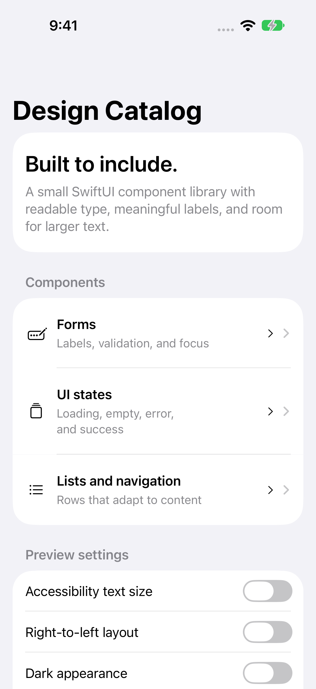

# Accessible Design System

A reusable SwiftUI component library and native catalog for accessible product interfaces.

[](https://github.com/DawoodAamir/Accessible-Design-System/actions/workflows/ci.yml)

[](LICENSE)



## Features

- Use scalable system typography, wrapping content, and minimum 44-point actions.
- Keep field labels, helpful validation, loading, empty, error, and success states consistent.
- Combine meaningful VoiceOver labels and hide decorative symbols.
- Preview large accessibility text, dark appearance, and right-to-left layout.

## Run locally

Open **Accessible Design System.xcodeproj** and run the shared scheme. Explore Forms, UI states, and Lists. Switch the preview to accessibility text size, RTL, or dark appearance.

To reuse the components, add this repository as a Swift Package dependency and import `AccessibleDesignKit`:

```swift
LabeledField("Email", text: $email, error: FormValidation.email(email))
PrimaryAction("Save", loading: saving) { save() }
StatusMessage("Changes saved", message: "Your edits are stored on this device.", kind: .success)
```

The catalog validates a local form and simulates a short loading state. It sends no form data to a service. `SettingsRow`, `EmptyState`, and semantic tokens are also public. Components support iOS 15 and macOS 12; the catalog is an iOS app.

Layout previews help catch truncation; they do not replace a VoiceOver audit. Check reading order, focus, Increase Contrast, Reduce Motion, and all Dynamic Type sizes on physical devices before using the library in a shipped product. Components have no decorative animations to disable. Automated tests cover validation, form error states, and large/RTL catalog navigation.

## Structure

- `Sources/Core`: domain logic and public reusable components, also exposed through a Swift Package for tests.
- `Sources/App`: native SwiftUI screens and platform integrations.
- `Tests/Core`: domain regression tests.
- `Tests/UI`: native workflow tests with isolated saved state and retained screenshots.
- `Resources`: assets, app icon, and platform configuration.

## Verification

Requires Xcode 15 or newer for these sources; local checks use the installed Xcode toolchain. No developer team is committed. Simulator builds need no personal signing identity. A physical device requires your own signing and capabilities.

```sh
swift test
swift test -c release
bash Scripts/test-ui.sh
```

CI runs the core tests, a Release build, and native workflow tests. The reference APIs have separate backend checks. See [verification notes](Docs/Verification.md) for the tested environment and remaining device checks.

## Privacy and contribution

The catalog keeps only in-memory preview state. Entered form data is not transmitted or persisted. No network requests, analytics, or account integration.

See [PRIVACY.md](PRIVACY.md), [CONTRIBUTING.md](CONTRIBUTING.md), and [LICENSE](LICENSE). All example people, assignments, accounts, and order identifiers are fictional. No App Store seller account is connected to this project.
